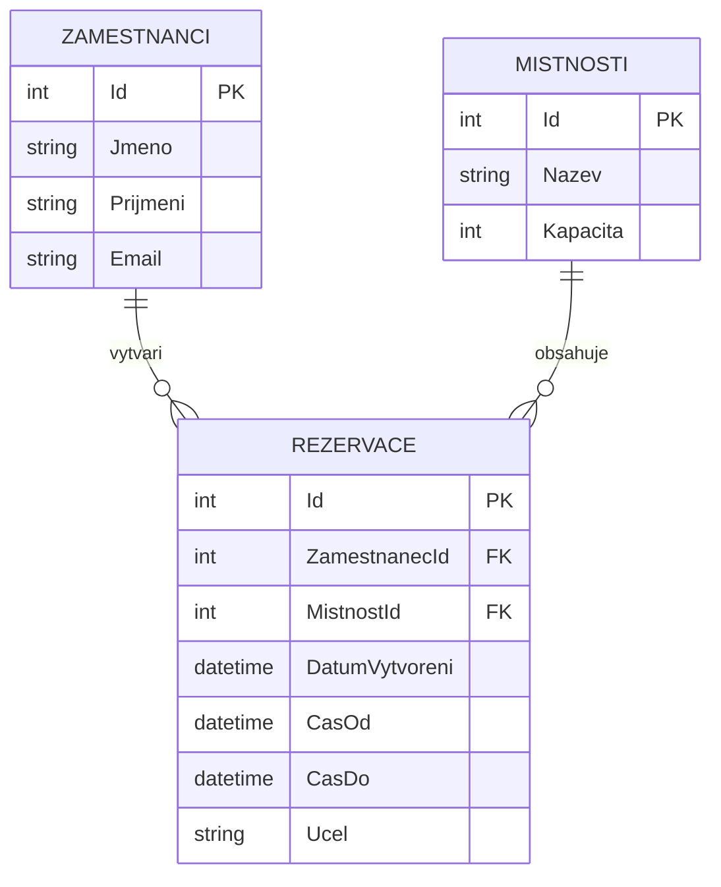

# Návrh databáze podle zadání Burda / Jodl

Požadavky vycházejí z dodaného návrhu zadání a analýzy. Technická struktura navazuje na výukový projekt ZCU-KPV/Sklad-Hotovy-Horejsi: datová knihovna, EF Core, WPF, ViewModels, Views, příkazy a konvertory. Implementace rezervací je vlastní.

Zaměstnanec i místnost mají 0 až N rezervací. Každá rezervace musí mít právě jednoho zaměstnance a právě jednu místnost. Vztah M:N není potřeba; účastníci schůzky se neevidují. Transformace vytváří tři tabulky, dva povinné cizí klíče a zákaz kaskádového mazání. Všechny neklíčové doménové atributy závisejí na celém primárním klíči bez tranzitivních závislostí: návrh odpovídá 3NF.

`DatumVytvoreni` a `RowVersion` u číselníků jsou technické auditní atributy převzaté ze vzoru. Stav rezervace z analýzy je vypočítán z aktuálního času (budoucí / probíhající / uskutečněná), neukládá se duplicitně. Neexistuje samostatný stav zrušení; smazat lze jen budoucí rezervaci. Opakující se rezervace nejsou podporovány.

| Požadavek | Zajištění |
|---|---|
| Kladná kapacita | DataAnnotations a SQL CHECK |
| Povinný účel, platný interval, nejvýše 8 hodin | DataAnnotations a SQL CHECK |
| Nové zahájení v budoucnosti | DbContext a SQL trigger |
| Zákaz překryvu místnosti i zaměstnance | DbContext a SQL trigger s transakčním zámkem |
| Zákaz odstranění odkazovaných číselníků | UI kontrola a FK RESTRICT |
| Trvalá historie | zákaz UPDATE/DELETE od zahájení v DbContext a SQL triggeru |
| Souběžná editace | SQL rowversion; konflikt se zobrazí uživateli |
| Dostupnost / historie / filtr zaměstnance a místnosti | dotazy EF a hlavní okno |
| Dva požadované agregované SQL dotazy | sql/02_Dotazy.sql |

Intervaly mají tvar `[od, do)`. Navazující rezervace se proto nepřekrývají. Časy se ukládají v UTC; UI je převádí podle místního časového pásma Windows. Nejednoznačné a neexistující místní časy při změně letního času formulář odmítne. Limit osmi hodin představuje skutečně uplynulý čas. Probíhající rezervace jsou chráněny stejně jako historie, aby nebylo možné obejít uchování historie před koncem schůzky.

SQL trigger chrání i přímé SQL zápisy a hromadné INSERT/UPDATE. Serializuje kontroly pomocí `sp_getapplock` a aktuální data čte s `UPDLOCK, HOLDLOCK`. Při kolizi transakcí může SQL Server jednu operaci zrušit jako deadlock; uživatel ji opakuje. Aplikační předběžná kontrola sama o sobě není ochranou před souběhem. Administrátor databáze může triggery vypnout; aplikace nepoužívá takové oprávnění při běžném provozu.
